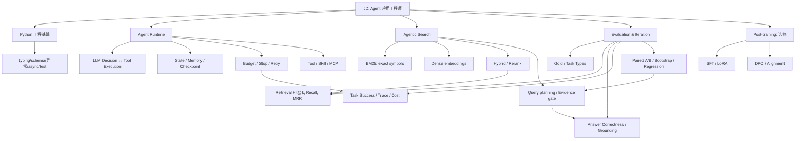

# 知识图谱 · 从概念到实现到面试

## 概念边界速记

| 概念 | 它解决什么 | 它不能单独保证什么 |
|---|---|---|
| Prompt | 任务目标与约束表达 | 可靠执行、权限、可复现 |
| Workflow | 预定义流程 | 开放式任务动态决策 |
| Agent policy / Planner | 决定下一动作 | 工具真正被执行、结果可靠 |
| Runtime | 调度执行、状态、预算、恢复 | 模型推理正确、检索质量 |
| Tool | 外部动作契约 | 安全授权、可用性 |
| Skill | 任务能力封装 | 运行时安装、数据合法 |
| MCP | Host/Client/Server 的标准协议 | 自动提供推理、权限、质量 |
| Memory | 历史/长期信息 | 崩溃后 exactly-once 副作用 |
| RAG | 取证据用于回答 | “有出处”就代表事实正确 |
| Agentic Search | 按反馈动态检索 | 更高成功率 / 更低成本 |
| SFT / DPO | 更新模型行为 | 自动修复工具协议、因果证明 |
| Evaluation | 衡量特定数据和指标 | 自动代表生产环境泛化 |

## 四条实际代码路径

- `cli.py → runtime.py → ReadOnlyTools → retrieval.py → Corpus`：一次任务如何运行。
- `CheckpointStore.save/load → events`：状态与证据如何记录。
- `cli.py → evaluation.measure() → paired_compare()`：如何评价改动。
- `llm.OpenAICompatiblePlanner`：模型被限制为“提搜索 query”的明确权限边界。

每学一个节点，需要回答：**它接收到什么、做什么、输出什么、有哪些边界条件、如何测试、失败时谁负责？**
